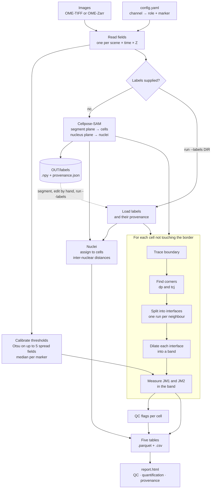

# junctionmapper

Measures cell–cell junctions in fluorescence microscopy images. Python library
and command-line tool.

This reimplements the method published as **Junction Mapper** (Imperial College
London, [doi:10.7554/eLife.45413](https://doi.org/10.7554/eLife.45413)). The
original is a Java desktop application where an operator clicks every cell and
corner. This version keeps the published parameter definitions and automates the
rest. The method is the original authors'.

**Contents**
[What it does](#what-it-does) ·
[Workflow](#workflow) ·
[Quick start](#quick-start) ·
[Configuration](#configuration) ·
[Before you run](#before-you-run) ·
[Outputs](#outputs) ·
[Differences from the original](#differences-from-the-original) ·
[Validation](#what-the-validation-harness-shows)

---

## What it does

1. Reads OME-TIFF or OME-Zarr images.
2. Segments cells and nuclei with Cellpose-SAM, or loads labels you supply.
3. Splits each cell boundary into **interfaces**, one stretch per neighbour.
4. Measures the published junction parameters along each interface, for up to
   two junction markers.
5. Writes five tidy tables and a standalone HTML report.

You declare which protein fills each role (`JM1`, `JM2`, `nucleus`). Nothing is
inferred from channel order, and the declaration is written into every output
row.

**Inputs.** `--input` takes one image or a directory of them. A directory is
read in sorted order and may hold `.tif`/`.tiff` files, OME-Zarr stores, or both.

An OME-Zarr store is a *directory* whose name ends `.zarr`, so it is taken as one input in its own right rather than scanned for files inside it.

Vendor formats (`.czi`, `.nd2`, `.lif`, ...) are out of scope. They are refused
by name, up front, instead of failing somewhere inside a reader.

**Status.** Under active development. Design: `docs/superpowers/specs/`. Plan:
`docs/superpowers/plans/`. Decisions log: `docs/decisions.md`.

---

## Workflow



Two ways to run it:

| | Command | Use when |
|---|---|---|
| **One stage** | `run` | You trust the automatic segmentation. |
| **Two stage** | `segment`, then `run --labels` | You want to inspect or hand-correct labels first. |

The labels directory is the seam between the two. `segment` writes it; an
editor such as napari can change it; `run --labels` reads it back unchanged and
skips Cellpose entirely.

---

## Quick start

The supported environment is an Apptainer image. `scripts/jm` runs a command
inside it, with the repo mounted so source edits take effect without a rebuild.

```bash
./scripts/build-image                 # once: builds container/junctionmapper.sif
./scripts/jm pytest -q                # run the test suite
```

`scripts/jm` does not pass `--nv`, so it runs on CPU. For Cellpose on a GPU,
call Apptainer directly:

```bash
apptainer exec --nv --cleanenv --env PYTHONNOUSERSITE=1 --env PYTHONPATH=/project/src \
  --bind "$PWD":/project --pwd /project container/junctionmapper.sif \
  python -m junctionmapper.cli run -c config.yaml -i images/ -o out/ --diameter 250
```

The examples below write the command as `junctionmapper`. That console script
exists only after `pip install -e '.[segmentation]'`. Inside the image the
package is not installed, so use `python -m junctionmapper.cli` instead, as
above.

**One stage**

```bash
junctionmapper run -c config.yaml -i images/ -o out/ --diameter 250
```

**Two stage**

```bash
junctionmapper segment -c config.yaml -i images/ -o seg/ --diameter 250
# inspect or edit seg/labels/ here
junctionmapper run -c config.yaml -i images/ -o out/ --labels seg/labels
```

`run` refuses to overwrite existing label files unless you pass
`--overwrite-labels`, because they may be hand-corrected work.

**Exit codes**

| Code | Meaning |
|---|---|
| 0 | Every field succeeded. |
| 1 | The command failed, or every field failed. Nothing was written. |
| 2 | Usage error (bad or missing option). |
| 3 | **Partial.** Some fields failed; the rest were written. Do not treat 3 as success. |

---

## Configuration

```yaml
channels:
  - {role: segment, channel: 3, marker: "Na/K-ATPase"}   # cells are drawn here; never measured
  - {role: JM1,     channel: 2, marker: "E-cadherin"}
  - {role: JM2,     channel: 1, marker: "p120"}
  - {role: nucleus, channel: 0, marker: "Hoechst"}
pixel_size_um: 0.0749      # used only when the image metadata has none
```

`JM1` and `nucleus` are required. `JM2` is optional. `segment` is required
whenever Cellpose runs (`segment`, or `run` without `--labels`). A misspelled
key is an error, not silently ignored.

The `segment` channel may not be the `JM1` or `JM2` channel. That config is
refused.

| Key | Default | Meaning |
|---|---|---|
| `channels` | — | Which image channel fills each role, and which protein it carries. |
| `pixel_size_um` | — | Fallback pixel size. Image metadata wins when present. |
| `dilation_px` | 2 | Band half-width, in dilation cycles. |
| `dilation_um` | — | Band width in µm instead; converted with the field's pixel size. |
| `epsilon_px` | 2.0 | Douglas–Peucker tolerance for `dp` corners. |
| `tcj_min_run` | 3 | Shortest contact run kept by `tcj`, in boundary pixels. |
| `neighbour_radius_px` | 2 | Window used to give each boundary pixel its neighbour. |
| `threshold` | — | Fixed intensity threshold per role. Overrides calibration. |
| `num_intra_cells` | 5 | Nearest nuclei recorded per nucleus. |
| `all_pairs` | false | Record every nucleus pair instead of the nearest few. |

---

## Before you run

Three things decide whether the numbers mean anything.

**1. Set `--diameter`.** It is the cell diameter in pixels. Cellpose-SAM does
not estimate it: with no value the image is not rescaled at all. Cells much
larger than about 30 px then shatter into fragments, with no error. Measure it
from your own cells (for example, median cell area → equivalent diameter). The
same value is applied to the nucleus plane, so nuclei that are much smaller
than the cells will be segmented less well.

**2. Choose the segmentation channel deliberately.** Cells are segmented from
the `segment` plane, which is never measured and can never be a measured
channel. A boundary placed on a marker's own signal makes that marker's
occupancy ~100% by construction.

- Prefer a membrane marker that does not depend on your experimental variable
  (for example phalloidin or Na/K-ATPase).
- A marker that does depend on it (a cadherin-complex protein in a cadherin
  knockout) still works, but cells that have lost it may not segment. Read
  missing cells as coverage loss, not as a measurement.

**3. Check the threshold.** Four parameters depend on an intensity threshold.
See [Intensity thresholds](#intensity-thresholds-one-value-per-marker-for-the-whole-run).

---

## Outputs

Every run writes five tables, each as `.parquet` and `.csv`, plus
`report.html`. All tables are keyed by `field_id`, so tables from many fields
concatenate.

| Table | One row per | Key columns |
|---|---|---|
| `interfaces` | cell-side interface × marker | `pair_id`, `interface_id`, `corner_method`, `role` |
| `cells` | cell | `cell_id`, `area_um2`, `n_neighbours`, `measured` |
| `nuclei` | nucleus | `nucleus_id`, `cell_id`, `orphan` |
| `nuclei_distances` | *ordered* nucleus pair | `nucleus_id`, `neighbour_nucleus_id`, `rank_from_nucleus` |
| `flags` | cell | `border_touching`, `isolated`, `degenerate`, ... |

Lengths come in `_px` and `_um`; areas in `_px` and `_um2`.

### The parameters

| Column | What it is |
|---|---|
| `interface_contour` | Length along the interface. |
| `straight_line_length` | Distance between its two corners. |
| `linearity_index` | straight-line / contour. 1 = perfectly straight. |
| `interface_area` | Area of the dilated band. |
| `marker_area` | Band area above the threshold. |
| `marker_intensity` | Sum of above-threshold values in the band. |
| `interface_occupancy_pct` | 100 × marker area / interface area. |
| `fragmented_contour` | Length of marker-positive stretches; gaps break it. |
| `junction_contour` | Length through marker-positive pixels; gaps bridged. |
| `junction_straight_line` | First to last marker-positive pixel. |
| `coverage_index` | fragmented contour / interface contour. |
| `intensity_per_*` | marker intensity / interface area. |
| `cluster_density_per_*` | marker intensity / marker area. |

### `interfaces` — one row per measured *cell-side* interface

**A row is not a junction.** Each row is one cell's view of one contact, with
its own band and its own numbers. A junction between two measured cells is
seen from both sides, and neither side is dropped: each is a real measurement.

How many rows one junction produces depends on the corner method:

| Method | Rows per junction | Why |
|---|---|---|
| `tcj` | exactly 2 (1 if the neighbour is not measured) | Cuts the boundary where the neighbour changes. |
| `dp` | usually more; often 2–5 per side, sometimes 10+ per junction | Corners ignore neighbours, so one contact is split wherever a corner falls. |

So count junctions with `pair_id`, never by counting rows or by assuming a
factor of two.

```python
df.pair_id.nunique()                    # number of junctions
df.groupby("pair_id").mean()            # one row per junction
```

| Column | Identifies |
|---|---|
| `pair_id` | The cell pair: `field\|method\|lo-hi`, ids sorted. Groups both sides. |
| `interface_id` | One cell-side interface. Shared by its JM1 and JM2 rows. |

Pooling rows without collapsing on `pair_id` over-weights interior junctions,
and under `dp` by a different amount for each junction. The report repeats this
next to every `n` it prints.

Three more columns say how far to trust a row:

| Column | Meaning |
|---|---|
| `contact_fraction` | Fraction of the interface actually touching its labelled neighbour. 1.0 for `tcj`; can be much lower for `dp`. |
| `low_contact_fraction` | `contact_fraction` < 0.8. Band metrics then partly measure free edge. |
| `closed_loop` | The interface is a whole boundary. Its `linearity_index` is near 0 from geometry, not tortuosity. |

### Intensity thresholds: one value per marker for the whole run

Four parameters depend on a threshold T per marker. Unless you set `threshold`
in the config, T is chosen once and applied to every field:

1. Pick up to five fields, spread evenly across the sorted `field_id`s.
2. Run Otsu on each.
3. Take the **median**, so one saturated or empty field cannot drag it.

Details:

- The CLI opens up to five input files, spread over the sorted inputs, to find
  those fields. With one field per file the two selections coincide.
- A multi-scene file offers all its fields, but Otsu only runs on the five
  chosen. Cost stays bounded.
- An unreadable calibration file is skipped and another tried, up to ten opens.
  The report records the degradation.
- Flat or non-finite planes contribute nothing. If all are like that, T = 0.0
  and the report says so.

Three columns record what happened, per row:

| Column | Meaning |
|---|---|
| `threshold` | The value applied. |
| `threshold_field_otsu` | What Otsu on this field alone would have given. |
| `threshold_deviates_from_run` | The two differ by more than 10%, with a floor of one grey level. |

The deviation flag is informational, not an error. On a low-valued plane the
one-grey-level floor dominates: with a run value of 2.28, the flag sets on the outer fields of an ordinary *default* run, where nothing was overridden. That
is intended; the floor exists so 16-bit planes do not trip on noise. Read it as
"this field's own plane would have been thresholded elsewhere."

A configured `threshold` overrides all of this, per role. The report shows a red
*threshold varied, not comparable* banner only when applied values differ
between fields by more than one grey level. It says which cause applies — an
override, or no run value could be resolved — and names the fields involved.

### `nuclei_distances` — one row per *ordered* nucleus pair

Each row is `(nucleus_id, neighbour_nucleus_id, rank_from_nucleus,
distance_px, distance_um)`. `rank_from_nucleus` is that nucleus's own ranking,
nearest first.

```python
df[df.rank_from_nucleus == 1]                     # nearest-neighbour distances
df[df.nucleus_id < df.neighbour_nucleus_id]       # one copy of each pair
```

With `all_pairs: true`, each pair appears twice, once from each end, each with
the rank it has for its own nucleus. A single row could not give both ends a
correct rank. `n_intra_distances` and `mean_intra_distance_*` in `nuclei` are a
plain `groupby("nucleus_id")` of this table.

---

## Differences from the original

The method is the original's. These are the places where the code knowingly
does not reproduce the original code. Each was verified against the Java
source and is commented where it diverges.

| # | What | In short |
|---|---|---|
| 1 | `linearity_index` | Reciprocal of the Java ratio. |
| 2 | Dilation band | Uniform; the Java's thins near the border. |
| 3 | Marker connectivity | One symmetric rule for both markers. |
| 4 | Nucleus assignment | Pixel plurality, not centroid. |
| 5 | Corners | Douglas–Peucker on the boundary, not the convex hull. |

### 1. `linearity_index` is the reciprocal of the Java's ratio

The Java's `getDistanceRatio` is contour / straight-line: ≥ 1, growing with
tortuosity. Here it is straight-line / contour: ≤ 1, where 1.0 is straight.
Same information, inverted. Take the reciprocal to compare with an old
spreadsheet.

### 2. The dilation band is uniform; the Java's thins at the image border

Both grow the band by repeated 3×3 dilation. But Java's
`ImageUtilities.getDilatedImage` (lines 660–690) drops a new pixel whenever any
neighbour falls outside `[1, w−2] × [1, h−2]`. That leaves a 2 px dead frame,
and the loss compounds each cycle.

Result: in the Java, interface area, marker area and marker intensity are all
low for cells near the border. This project dilates uniformly. Border-touching
cells are flagged and excluded anyway.

### 3. Marker connectivity is symmetric and the same for both markers

The Java's two marker walks disagree with each other, and JM1 disagrees with its
own user guide.

- **JM1** connects two above-threshold pixels when *either* coordinate differs
  by one. A step of (1 row, 30 cols) then counts as connected, bridging a gap
  the formula says should break.
- **JM2** uses *both* coordinates (correct), but also counts the step from an
  unstained pixel into each fragment, over-counting by one step per fragment.
  JM2 does report a fragmented contour and coverage index
  (`Membrane_SpreadSheet.java` lines 150, 169–170). What it lacks is junction
  contour, straight-line junction length and junction linearity.

Here, one rule for both: a step joins two consecutive above-threshold pixels
only when both coordinate differences are at most 1. That is 8-connectivity, as
the guide's formula describes, so JM1 and JM2 are directly comparable.

### 4. Nuclei are assigned to cells by pixel plurality, not centroid containment

The Java gives a nucleus to whichever cell contains its centroid
(`Cell_Nucleus.setCellMembrane` → `getSelectedMembrane(getGeometricMean())`).
That "centroid" is the floored midpoint of the bounding box. A nucleus whose
centroid lands on a junction or gap goes to no cell.

Here the reported centroid keeps the Java formula, but assignment goes to the
cell holding most of the nucleus's pixels (ties to the lowest label). A nucleus
is an orphan only if it overlaps no cell.

This matters in discohesive tissue, where nuclei straddle junctions and gaps
often. A centroid rule inflates orphan and anucleate counts in exactly the
condition being studied.

### 5. Corners are found by Douglas–Peucker on the boundary, not on the convex hull

The user guide describes Douglas & Peucker (1973) on the cell outline. The code
does something else: `Cell_Membrane.getDouglasPeucker` takes the **convex hull**
first, then runs Douglas–Peucker on the hull vertices. It also skips the last
interior vertex of each range and uses an integer-truncated slope.

Consequences, from the code and from driving the Java classes headless on the
control grid built by `scripts/java_reference.py`:

- **A concave vertex can never be a corner.** The hull discards it. Cells in
  discohesive tissue are often concave.
- **The corner count is click-dependent.** The flood fill starts at the clicked
  pixel, and the pixels it reaches decide the hull. On the control grid's nine
  rectangles, clicked at the recorded seed, the Java found four corners,
  matching this project. Another click in the centre cell — one of 14 pixels
  tied for maximum distance to the boundary — gives three, so one "interface"
  spans two sides. The click is part of the input, which is why
  `reference.csv` records it as `seed_row` and `seed_col`. See "Why the click
  matters" in `tests/validation/README.md`.
- **No published epsilon.** The Java slider starts at 0, where only hull
  vertices qualify. `dp` corner counts are not comparable to any published
  Junction Mapper run.

A review-time measurement over 148 interfaces across jogged, staircase, Voronoi and hexagonal geometries also found that a regular hexagon yields eight to ten corners, none of them at a vertex. That driver is not committed and this repository cannot regenerate the number. Treat it as a one-off observation, not as evidence this project ships.

This project runs Douglas–Peucker on the traced boundary, as the guide
describes. A corner can land on a concave turn, and a rectangle has four.
Interface decompositions and corner counts therefore differ from the original
for any non-convex or oblique cell.

**The `tcj` method is new.** It cuts where the neighbour changes. `dp` corners
ignore neighbours, so each `dp` run is assigned to whichever neighbour covers
most of it. Two visible costs:

| Effect | Example | Flag |
|---|---|---|
| A `dp` interface can be mostly free edge. | A neighbour touching 8 px of a 20 px side still wins: `dp` reports 19 px of contour, `tcj` 11 px. The extra ~11 px dilute coverage and occupancy. | `contact_fraction`, `low_contact_fraction`, `dp_low_contact` |
| A short real contact can vanish. | At 4 px of contact, background wins the plurality and `dp` emits nothing; `tcj` finds it. | `dp_missed_tcj_contact` |

The rule stays: it is `dp`'s published partition, and `dp` has no neighbour
information to do better. What is new is that its cost is now measured, in the
tables and the report.

This divergence is about *which* interface is measured, not *how*. The
validation harness relies on that: it takes the Java's own corner pixels as
input and compares measurements along the shared path.

---

## What the validation harness shows

`scripts/java_reference.py` drives the original's classes headless and writes
`tests/validation/reference.csv`. `./scripts/jm pytest tests/validation` then
compares this project's functions along the same path, between the Java's two
corner pixels.

Numbers below are from `tests/validation/README.md`: a real-Java run of 208
interfaces (416 rows, one per interface × marker) over two Voronoi tilings and a
hexagonal tiling.

| Comparison | Rows | Result |
|---|---|---|
| Paths identical pixel for pixel (straight rows) | 20 of 416 rows (10 interfaces, ~5%) | Areas and intensity **identical**. Contour, straight-line, linearity and junction lengths within 1e-9. |
| Paths differ at the edge-map seam | the other 396 | Areas within 15% or 16 px, intensity within 15%, linearity within 0.35. |
| `fragmented_contour_px`, `coverage_index` | all | Different on purpose (divergence 3). |

- The harness refuses a reference with no straight row, so the exact checks can
  never silently skip.
- Worst observed on the 396: interface area −15 to +3 px (11.3%), marker area
  −12 to +6 px, intensity 14.0%, linearity 0.31.
- Those differences come from the edge map, not the measurement. The Java's
  edge set is two pixels thick on oblique edges, its walk follows the inner row,
  and it cuts convex corners diagonally. The paths are not the same pixels.
- `fragmented_contour_px` and `coverage_index` are recorded and never asserted.
  Contour and junction lengths on the 396 are also recorded rather than
  asserted.

**The accurate claim:** given the same interface path, the formulas reproduce
the original's numbers — exactly where the paths coincide, and within a
measured envelope where the edge map makes them differ. Not "every metric
matches exactly on every interface"; divergence 3 alone makes that false.

Running the comparison needs a JDK and the Java checkout. Without
`reference.csv` those tests skip and say what is missing. The procedure is in
`tests/validation/README.md`.
